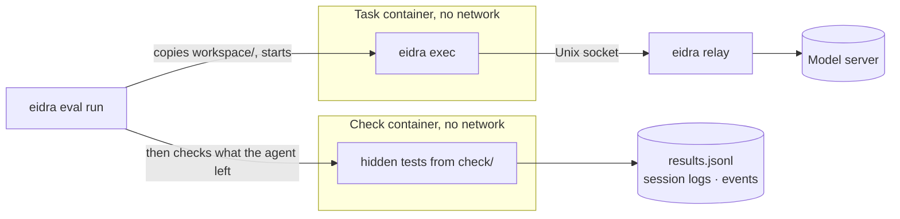

# Eidra

**A coding agent for the terminal, written in Rust and tuned for one local model, with an eval
harness that measures every change.**


Eidra reads and edits code, runs commands and tests, and works through a task until it is done.
You can talk to it in an inline terminal UI, or give it a task to do unattended. It speaks the
OpenAI chat-completions API. Its prompts, tools and request settings are tuned and measured
against one model on my own hardware: Qwen3.8 Flash-Next, served by
[radiance](https://codeberg.org/StillDeadcode/radiance).

## Why I built it

I run a coding model locally, on two Radeon AI PRO R9700 GPUs. On a local server, the speed of an
agent depends on the prompt cache. When anything early in a prompt changes, the server computes
everything after that point again. That costs 25–45 seconds for every 100K tokens.

So Eidra follows one rule: each request is the previous prompt with the new turns appended, byte
for byte. The system prompt, the tools and the reasoning effort are fixed for a session. Each reply
goes back to the server exactly as it was streamed. In the first unattended run, 91% of 300K prompt
tokens came from the cache. In the SWE-rebench baseline, 97–99% did.

I also wanted to judge each change to the harness by numbers, not by impression. That is why Eidra
has its own eval runner, which runs tasks in containers that can reach only the model.

## Key features

- **Interactive TUI.** It draws inline, in the terminal's own scrollback. It streams the reply and
  shows a status line with context use, cache reuse and prefill and decode speed. It has `@file`
  attachments, `!command`, a `/` command menu and input history.
- **Unattended runs.** `eidra exec` does one task and exits with a code that says how the run
  ended. `--json` prints events as JSON lines.
- **Tools.** bash with background jobs, `read`, `edit`, `write`, `glob`, `grep`, a todo list,
  subagents (`task`), skills (`skill`) and `finish`.
- **Subagents.** The model can hand work to subagents, up to three at a time. In an interactive
  session, a subagent can work in the background while you keep talking to the agent.
- **Confirmation policy.** Commands are parsed with tree-sitter-bash. A pattern such as
  `git push` is caught inside pipelines, `&&` lists, subshells, `$(...)` and `bash -c` scripts.
- **Post-edit checks.** After each edit of a Python file, the agent sees the problems that the edit
  introduced (syntax, ruff, ty). An edit that changes the project's committed tests says so.
- **Checkpoints.** Each turn is saved in a git repository of Eidra's own, apart from the project's.
  `/undo` puts back what a turn changed, and `/diff` shows it.
- **Long sessions.** Past 200K tokens, the conversation is summarised and continues from the
  summary. Each session is an append-only JSONL log, which you can resume (`--continue`,
  `--resume`). `eidra replay` sends a recorded request again.
- **Images and PDFs.** The model can see images, and reads PDFs through poppler.
- **AGENTS.md and skills.** Eidra reads your AGENTS.md and the project's. It loads skills from
  `~/.agents/skills`, the folder that Claude Code, Codex and other agents share.
- **Evals.** `eidra eval` runs task suites in containers with no network except the model. It runs
  its own task format and Harbor-format tasks (SWE-rebench, Terminal-Bench), and it reports,
  compares and regrades runs.
- **Prefix-cache probe.** `eidra probe` measures how much of each prompt the server's cache reuses
  under different request policies.
- **TLS relay.** `eidra relay --listen` puts TLS in front of the model server, with a certificate
  that it makes itself. Clients trust that certificate by its SHA-256 pin. There is no certificate
  authority or domain name to set up.
- **One static binary.** The binary is built with musl, so it runs on the host or in any Linux
  container. The build needs only Docker.

## Architecture


| Crate | Role |
|---|---|
| [`eidra-llm`](crates/eidra-llm) | The OpenAI-compatible client: request types, SSE streaming, turn accumulation and TLS with a pinned certificate. It knows nothing about agents. |
| [`eidra-core`](crates/eidra-core) | The agent: the session log, the loop, the tools, the confirmation policy, model profiles, the context budget, checkpoints and skills. It never prints. Frontends render the events it emits. |
| [`eidra-tui`](crates/eidra-tui) | The interactive frontend, drawn with crossterm. |
| [`eidra`](crates/eidra) | The binary and its commands: the TUI, `exec`, `eval`, `probe`, `replay`, `relay` and `sessions`. |

Everything specific to the model lives in a profile directory: the system prompt, tool
descriptions, request settings and context limits. The built-in profile,
[profiles/qwen3.8-radiance](profiles/qwen3.8-radiance), is compiled into the binary. So tuning
means editing these files, not the code.

An eval attempt for one of the suite's own tasks runs like this:



A Harbor-format task runs the agent and then the task's verifier in one container of the task's
own image. The design, with measurements, is in [docs/DESIGN.md](docs/DESIGN.md).

## Tech stack

| Area | Tools |
|---|---|
| Language | Rust (2024 edition, 1.99), Tokio |
| HTTP and TLS | reqwest, rustls with ring, rcgen |
| Terminal UI | crossterm, pulldown-cmark |
| Code understanding | tree-sitter (bash, Python), ripgrep's crates (`grep-searcher`, `ignore`, `globset`) |
| Media | `image` for resizing, poppler for PDFs |
| Containers | Docker: a static musl build in `rust:1.99.1-alpine`, and a `python:3.13-slim` runtime image with uv, ruff, ty, ripgrep, fd and git |
| Tests | cargo tests, and Python scripts that drive the TUI in a pseudo-terminal against a fake server |
| Model | Qwen3.8 Flash-Next on radiance, behind llama-swap |

## Quick start

You need:
- Docker.
- An OpenAI-compatible chat-completions server with tool calling. The built-in profile expects
  Qwen3.8 Flash-Next at `http://127.0.0.1:8000/v1`. For another server or model, set
  `EIDRA_BASE_URL` and `EIDRA_MODEL` (see [Configuration](#configuration)). Eidra's defaults are
  measured only against radiance, so another model may need a profile of its own.

Build the image. This compiles the static binary and makes the image that the agent runs in:

```bash
git clone https://github.com/TariqKirsten/eidra-cli.git
cd eidra-cli
docker build -t eidra .
```

Give it your settings. Eidra reads them from the environment:

```bash
cp .env.example .env         # then fill in your server's API key
set -a; . ./.env; set +a     # export the settings into this shell
```

Run it in the project that you want to work on:

```bash
cd /path/to/your/project
/path/to/eidra-cli/scripts/eidra-docker                                     # interactive session
/path/to/eidra-cli/scripts/eidra-docker exec "Make the tests pass, then finish."  # one task, unattended
```

> [!WARNING]
> The agent runs the commands it chooses, as you, without asking first. Only the commands on its
> confirm list need your approval (`--confirm "git push"`). That is why the quick start runs it in
> a container: `scripts/eidra-docker` gives it the current directory, `~/.eidra` and your skills
> (read-only), not your whole machine. The container shares the host's network, so that it can
> reach a server on `127.0.0.1`.

To run it without a container, build the binary alone and run it in your project's directory:

```bash
docker build --target export --output dist .   # the static binary, at dist/eidra
```

With a Rust 1.99 toolchain, `cargo build --release --locked -p eidra` also works.

## Configuration

Eidra reads these environment variables. [.env.example](.env.example) lists them with
placeholders.

| Variable | What it sets |
|---|---|
| `RADIANCE_API_KEY` | The model server's API key. The built-in profile reads the key from this variable. If it is empty, no key is sent. |
| `EIDRA_BASE_URL`, `EIDRA_MODEL` | Another server or model than the profile's (`--base-url`, `--model`). |
| `EIDRA_TLS_PIN` | The SHA-256 pin of an https server's own certificate, which `eidra relay --listen` prints (`--tls-pin`). |
| `EIDRA_PROFILE` | A profile directory of your own, instead of the built-in one (`--profile`). |
| `EIDRA_HOME` | Eidra's own directory, instead of `~/.eidra`. |
| `EIDRA_SESSION_DIR` | Where session logs go, instead of `~/.eidra/sessions` (`--session-dir`). |
| `EIDRA_IMAGE`, `EIDRA_SKILLS` | For `scripts/eidra-docker`: the image to run (default `eidra`) and the skills folder to mount (default `~/.agents/skills`). |

Other settings:
- **Profiles.** A profile is a directory with `profile.toml` and `system.md`. Copy
  [profiles/qwen3.8-radiance](profiles/qwen3.8-radiance) to start one. Its comments explain each
  setting: the request fields, the context limit and compaction threshold, the tools, subagents,
  diagnostics and the commands that need approval.
- **`~/.eidra`.** Eidra keeps your `AGENTS.md`, the session logs and the checkpoints here. Your
  `AGENTS.md` goes into every session, along with the project's.
- **Skills.** Each skill is a folder in `~/.agents/skills` with a `SKILL.md`. Run one yourself with
  `/name`, or let the agent load it when a task fits it.

## Usage

With the binary on your `PATH` (for a session or a task, `scripts/eidra-docker` works in its
place):

```bash
eidra                          # interactive session in the current directory
eidra --continue               # continue this directory's latest session
eidra sessions                 # list this directory's sessions
eidra exec "Fix the failing test, then finish."
eidra exec --task-file task.md --json > events.jsonl
eidra eval run --repeats 3     # run the task suite, three attempts per task
eidra eval compare evals/runs/<a> evals/runs/<b>
eidra probe                    # measure the server's prefix cache
eidra relay --listen 0.0.0.0:8443   # TLS in front of the model server; prints its pin
```

`eidra exec` ends with one of these exit codes:

| Code | Meaning |
|---|---|
| 0 | finished |
| 1 | error |
| 2 | request limit reached |
| 3 | context limit reached |
| 4 | the model replied without finishing |
| 130 | interrupted |

More detail:
- [docs/USAGE.md](docs/USAGE.md): the container and its mounts, Windows, reaching the model over
  TLS, and the interactive session's keys and commands.
- [evals/README.md](evals/README.md): the eval commands and the task format.
- [docs/DESIGN.md](docs/DESIGN.md): the design, the measurements and the open questions.

## Development

```bash
scripts/cargo build                       # cargo in the pinned Rust image; the host needs only Docker
scripts/cargo test --workspace
scripts/cargo clippy --workspace --all-targets
scripts/cargo fmt --all
scripts/tui/offline.py                    # the TUI end to end against a fake server, no GPU
```

## Status and roadmap

Eidra is a personal project, built for my own machine. It is not packaged or released, so you
build it from source.

Done:
- The agent loop, tools, confirmation policy and `eidra exec`.
- The inline TUI, resumable sessions, `@` files and `!` commands.
- Python diagnostics, images and PDFs, nested `AGENTS.md`, compaction and checkpoints.
- Subagents, in the foreground and in the background.
- Skills from `~/.agents/skills`.
- The runtime image, and a TLS relay with certificate pinning.
- The eval runner, with sealed containers and Harbor-format tasks.

Results so far:
- My own seven-task suite: 7 of 7 tasks pass.
- 16 Python tasks from SWE-rebench's July 2026 snapshot: 19 of 32 attempts pass (59%). That is
  about the same as the first baseline (9 of 16). [docs/DESIGN.md §16](docs/DESIGN.md) has the
  analysis of the failures.

Next:
- At `finish`, compare the project's tests with the last commit, to catch tests that the agent
  changed through bash. Measure that against the current harness.
- Harder tasks and baselines, and measure whether subagents help.
- Tune the compaction threshold, the thinking policy and the tool schemas with evals.
- Encryption at rest for `~/.eidra` (sessions, `AGENTS.md` and undo snapshots). It is on the
  `encryption` branch until it is tested.

Not planned: other providers' native APIs, native Windows or macOS builds (Windows works through
Docker Desktop), multi-arch builds, embeddings or repo maps, and any security boundary beyond the
container's.

## License

[MIT](LICENSE)
