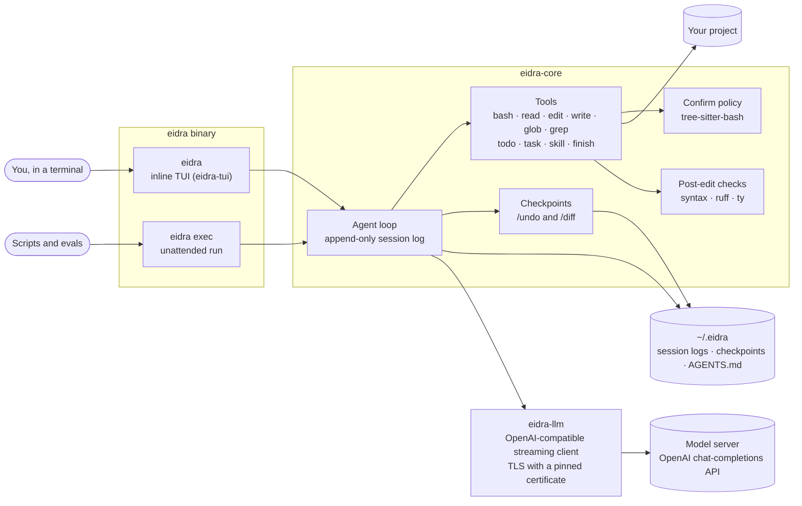

# Eidra

**A terminal coding agent in Rust, tuned for one local model and measured with its own eval
harness.**


Eidra reads and edits code, runs commands and tests, and works on a task until it's done. It runs
as an inline terminal UI or headless (`eidra exec`), against any OpenAI-compatible chat-completions
server. Its prompts, tool schemas and request settings are tuned for Qwen3.8 Flash-Next, served by
[radiance](https://codeberg.org/StillDeadcode/radiance) on two Radeon AI PRO R9700 GPUs.

## Why I built it

I wanted control over my own harness, and to learn what it takes to build one.

## Highlights

- **Eval harness.** `eidra eval` runs task suites in network-isolated containers, with the model
  reached through a Unix-socket relay. It takes its own task format and Harbor tasks (SWE-rebench,
  Terminal-Bench). Results so far: 7/7 on my own suite, and 19 of 32 attempts (59%) on 16 Python
  tasks from SWE-rebench ([analysis](docs/DESIGN.md#165-the-july-2026-swe-rebench-suite-2026-10-27)).
- **Model profiles.** The system prompt, tool schemas, request settings and context limits live in
  a profile directory, separate from the code.
- **Command confirmation.** Commands are parsed with tree-sitter-bash, so a confirm pattern like
  `git push` is caught inside pipelines, `&&` lists, subshells, `$(...)` and `bash -c`.
- **Sessions and checkpoints.** Append-only JSONL session logs that can be resumed or replayed,
  with compaction past 200K tokens. Each turn is snapshotted in a separate git repo for `/undo` and
  `/diff`.
- **Subagents.** Up to three at once, in the foreground or in the background while you keep
  talking.
- **Post-edit feedback.** Python edits get syntax, ruff and ty diagnostics, and edits to committed
  tests are flagged.
- **Deployment.** A static musl binary, built with Docker only. `eidra relay` puts TLS with a
  pinned self-signed certificate in front of the model server.

Also: images and PDFs, AGENTS.md, skills from `~/.agents/skills` (shared with Claude Code and
Codex), and a prefix-cache probe (`eidra probe`).

## Architecture



| Crate | Role |
|---|---|
| [`eidra-llm`](crates/eidra-llm) | OpenAI-compatible client: request types, SSE streaming, TLS with a pinned certificate. No agent logic. |
| [`eidra-core`](crates/eidra-core) | The agent: session log, loop, tools, confirm policy, profiles, context budget, checkpoints, skills. Emits events and never prints. |
| [`eidra-tui`](crates/eidra-tui) | The interactive frontend (crossterm). |
| [`eidra`](crates/eidra) | The binary: the TUI, `exec`, `eval`, `probe`, `replay`, `relay` and `sessions`. |

The built-in profile, [profiles/qwen3.8-radiance](profiles/qwen3.8-radiance), is compiled into the
binary. The design and its measurements are in [docs/DESIGN.md](docs/DESIGN.md), and the eval
runner in [evals/README.md](evals/README.md).

## Tech stack

| Area | Tools |
|---|---|
| Language | Rust (2024 edition, 1.99), Tokio |
| HTTP and TLS | reqwest, rustls with ring, rcgen |
| Terminal UI | crossterm, pulldown-cmark |
| Code understanding | tree-sitter (bash, Python), ripgrep's crates (`grep-searcher`, `ignore`, `globset`) |
| Media | `image` for resizing, poppler for PDFs |
| Containers | Docker: a static musl build in `rust:1.99.1-alpine`, and a `python:3.13-slim` runtime image with uv, ruff, ty, ripgrep, fd and git |
| Tests | cargo tests, and Python scripts that drive the TUI in a pseudo-terminal against a fake server |
| Model | Qwen3.8 Flash-Next on radiance, behind llama-swap |

## Quick start

You need Docker and an OpenAI-compatible chat-completions server with tool calling. The built-in
profile expects Qwen3.8 Flash-Next at `http://127.0.0.1:8000/v1`. For another server or model, set
`EIDRA_BASE_URL` and `EIDRA_MODEL`; another model may need a profile of its own.

```bash
git clone https://github.com/TariqKirsten/eidra-cli.git && cd eidra-cli
docker build -t eidra .
cp .env.example .env          # fill in your server's API key
set -a; . ./.env; set +a      # export it into this shell

cd /path/to/your/project
/path/to/eidra-cli/scripts/eidra-docker                                         # interactive
/path/to/eidra-cli/scripts/eidra-docker exec "Make the tests pass, then finish."  # headless
```

> [!WARNING]
> The agent runs commands without asking, except those on its confirm list
> (`--confirm "git push"`). `scripts/eidra-docker` limits it to the current directory, `~/.eidra`
> and your skills (read-only), but the container shares the host's network to reach a local model
> server.

[docs/USAGE.md](docs/USAGE.md) covers configuration, the container's mounts, TLS, the session's
keys and commands, exit codes, building without Docker, and development.

## Status

A personal project, built for my own machine. There are no releases, so build from source.

Next:
- Harness-level tracing, then testing whether the model can improve the harness it runs in.
- At `finish`, diff the project's tests against the last commit, to catch test edits made through
  bash.
- Harder tasks and baselines, including whether subagents help.
- Eval-driven tuning of the compaction threshold, thinking policy and tool schemas.
- Encryption at rest for `~/.eidra`, on the `encryption` branch until it's tested.

## License

[MIT](LICENSE)
